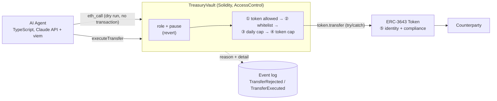

# Compliant RWA Treasury with an AI Agent

[](https://github.com/luk267/rwa-treasury-agent/actions/workflows/ci.yml)

Tokenized securities (real-world assets, RWAs) may only move between verified
holders. Under ERC-3643 the issuer enforces this inside the token: an identity
registry, compliance rules, frozen wallets. A treasury that holds such tokens
adds rules of its own on top: which tokens it moves, whom it pays, how much of
each token per counterparty per day, how much of each token may leave per day.

This project lets an AI agent run that treasury without trusting it. The agent
proposes transfers. A Solidity vault applies the treasury's rules, then hands
the transfer to the token, which applies the issuer's rules. Every refused
attempt stays in the on-chain log with a typed reason, including the token's
own error.

The agent (TypeScript, `@anthropic-ai/sdk` + viem) runs a short tool loop over
the Claude Messages API with three tools: read holdings, simulate a transfer,
submit one. Its reasoning is observability, not authorization.

---

## Demo

Four scenes, replayed by [`scripts/demo.sh`](scripts/demo.sh) against the
local stack:

| Scene | Prompt                      | Outcome                                                         |
| ----- | --------------------------- | --------------------------------------------------------------- |
| 1     | `show the vault holdings`   | 100,000 MOCK in the vault                                       |
| 2     | `transfer 500 MOCK to cp1`  | Executed, within all limits                                     |
| 3     | `transfer 6000 MOCK to cp1` | Refused by the vault: cp1's daily cap is 5,000 MOCK             |
| 4     | `transfer 100 MOCK to cp3`  | Refused by the token: `UnverifiedIdentity()`, cp3 has no KYC    |

Scene 4 from a real run, shortened (`[...]` marks the cuts):

```text
=== Scene 4/4: Rejected by the token: unverified identity ===
> transfer 100 MOCK to cp3

→ get_portfolio({})
← { [...] "symbol": "MOCK", "balance": "99500" [...] }

→ check_transfer_feasibility({"token":"0x5FbDB2315678afecb367f032d93F642f64180aa3","to":"0x976EA74026E726554dB657fA54763abd0C3a0aa9","amount":"100"})
← {
  "feasible": false,
  "reason": "ERC3643Compliance",
  "detail": {
    "raw": "0x58c10a24",
    "decoded": "UnverifiedIdentity()"
  }
}

I didn't send the transfer because the dry-run was rejected. **No transfer
was made.**

**Why it was rejected:** The MOCK token itself refused it (`ERC3643Compliance`,
error `UnverifiedIdentity()`). cp3 (`0x976EA74026E726554dB657fA54763abd0C3a0aa9`)
has no verified identity (KYC) in MOCK's identity registry. [...]

**All the vault's own limits passed:**
- **Token allowed:** Yes. The vault holds 99,500 MOCK.
- **cp3 approved:** cp3 is an active counterparty.
- **cp3's daily cap:** 1,000 MOCK, with 0 used today, so 100 fits.
- **Vault's daily limit for MOCK:** 8,000 MOCK across all recipients, with 500
  used today, so 7,500 is left.
[...]
--- done (turns: 3) ---
```

The [Quick start](#quick-start) shows how to run it yourself.

---

## Status

Built during ETHGlobal Open Agents (24 April - 6 May 2026) and reworked since.
It runs end to end on a local Anvil chain against `MockERC3643`, a test token
modeled on T-REX v5.

Not audited. Not for production use.

---

## How it works

Three layers, none trusting the layer above: the agent proposes a transfer,
the vault applies the treasury's policy, the ERC-3643 token applies the
issuer's rules. The vault owns the tokens and the agent key holds only
`AGENT_ROLE`, so `executeTransfer` is the agent's only way to move them.



The vault follows one rule for refusals:

- **Authorization reverts.** A caller without `AGENT_ROLE`, any call while
  the vault is paused, and an amount of 0 revert. The caller had no right to
  ask.
- **Policy decisions are logged.** Five gates run in order. A refusal emits
  `TransferRejected(token, to, amount, reason, detail)`, and the transaction
  still succeeds:
  1. Token allowlist (vault)
  2. Counterparty whitelist (vault)
  3. Daily cap per counterparty and token (vault)
  4. Daily outflow cap per token, over all counterparties (vault)
  5. ERC-3643 compliance (token). The vault calls `token.transfer` in
     try/catch and keeps the token's revert data in `detail`. A token that
     fails without a reason (no revert data, which includes running out of
     gas, or `false`) makes the vault revert: that is not a policy decision.

`executeTransfer` returns the same outcome as
`(bool executed, RejectReason reason, bytes detail)`, so a calling contract
does not have to read logs.

The vault's gates are default-deny: an unknown token, an unknown recipient or
a cap that was never set blocks the transfer. "Unlimited" has to be set
explicitly.

A monitor therefore finds every blocked attempt with one `eth_getLogs` filter
on `TransferRejected`, without a trace API or an archive node. A successful
transfer emits `TransferExecuted` and updates the daily counters in the same
transaction.

Component responsibilities, the full transfer flow, the issuer's rights and a
comparison with Safe + Zodiac Roles, MetaMask Advanced Permissions and
ERC-8226 are in [`docs/architecture.md`](docs/architecture.md). Threats,
mitigations with their tests, and known limitations are in
[`docs/threat-model.md`](docs/threat-model.md). Two decisions have their own
records:

- [ADR-0001: Policy rejections emit an event instead of reverting](docs/adr/0001-emit-instead-of-revert.md)
- [ADR-0002: Separate roles, a guarded admin, and no upgrade mechanism](docs/adr/0002-admin-rights-and-no-upgradeability.md)

---

## Design notes

- **Defense in depth.** Four cheap vault checks run before the more
  expensive ERC-3643 call. The vault owns the tokens, so the agent has no
  path that skips the gates.
- **Counters update on success only.** `_dailySpent` and `_assetDailySpent`
  are written after `token.transfer` returns true. A rejected ERC-3643 call
  leaves the counters untouched (verified by
  `test_executeTransfer_erc3643Rejects_dailyCapNotConsumed`). Because the
  write follows the external call, `executeTransfer` has a re-entrancy guard
  (verified by `test_executeTransfer_reentrantToken_cannotBypassCaps`).
- **The pre-check explains, it does not protect.** The agent runs every
  transfer as an `eth_call` first and reads the return value, so it can tell
  the operator which gate would refuse. That is an aid for the operator and the model, not a
  control: on submission the vault runs every check again. The same holds for
  the `Proceed? [y/N]` prompt before each real transfer.

---

## Quick start

Requires Foundry 1.9.0 and Node.js 22+. Start each terminal in the repo root.

Build and test the contracts:

```bash
git submodule update --init --recursive
(cd contracts && forge build && forge test)
```

Start the local stack (Anvil + deployed vault + funded mock token):

```bash
./scripts/local-dev.sh
```

The script starts Anvil, deploys `TreasuryVault` and `MockERC3643`, allows
the token with a daily outflow cap, whitelists three counterparties with a
daily cap each, and writes addresses to `deployments/local.json`. The token verifies the vault, `cp1` and `cp2`. It
does not verify `cp3`, so a transfer to `cp3` passes the vault's gates and is
then rejected by the token with `UnverifiedIdentity()`. Anvil runs until you
press Ctrl+C.

In a second terminal, set up and run the agent:

```bash
cd agent && npm install
cp ../.env.example .env                # then set ANTHROPIC_API_KEY
npm start "show the vault holdings"
npm start "transfer 500 MOCK to cp1"   # asks "Proceed? [y/N]" before sending
../scripts/demo.sh                     # the four demo scenes
```

Every agent run calls the Claude API and uses a little API credit. See
[`agent/README.md`](agent/README.md) for flags, exit codes and configuration.

---

## Stack

| Layer     | Tooling                                                               |
| --------- | --------------------------------------------------------------------- |
| Contracts | Solidity 0.8.38, Foundry 1.9.0, OpenZeppelin `AccessControl`          |
| Token     | ERC-3643 (T-REX) interface; `MockERC3643` for local tests             |
| Agent     | TypeScript (strict), Node 22+, viem, `@anthropic-ai/sdk`, zod         |
| CI        | GitHub Actions: `forge` fmt, lint, build, test; `tsc`, `npm test`     |

---

## Repository layout

```
contracts/
  src/TreasuryVault.sol         policy gate + ERC-3643 delegation
  src/interfaces/IERC3643.sol   minimal T-REX interface
  test/unit/                    unit tests, one suite per concern
  test/mocks/MockERC3643.sol    T-REX v5-style test double: identity, freeze, pause, forced transfer
  test/mocks/                   plus small tokens that fail without a reason, burn gas or re-enter
  script/DeployLocal.s.sol      local Anvil deployment

agent/
  src/index.ts                  entry point: setup, operator prompt, exit codes
  src/loop.ts                   tool loop over the Claude Messages API
  src/outcome.ts                decodes the token's revert data in TransferRejected
  src/tools/                    get_portfolio, check_transfer_feasibility, execute_transfer
  src/prompt.ts                 system prompt: simulate-before-execute, reject-reason mapping

docs/
  architecture.md               component layout, transfer flow, gate reference, alternatives
  threat-model.md               threats, mitigations with tests, known limitations
  adr/                          architecture decision records

scripts/
  local-dev.sh                  Anvil + deploy + write deployments/local.json
  demo.sh                       replays the four demo scenes against the local stack
```

---

## Tests

```bash
cd contracts
forge test -vv         # full suite, verbose
forge test --summary   # pass/fail summary
```

The suites cover the vault's gates, the role split and the ERC-3643 integration:

| Suite                                   | Focus                                         |
| --------------------------------------- | --------------------------------------------- |
| `TreasuryVault.Skeleton.t.sol`          | Constructor, roles, pause / unpause           |
| `TreasuryVault.Roles.t.sol`             | One account per role, two-step admin handover |
| `TreasuryVault.Whitelist.t.sol`         | Counterparty add / re-add / deactivate, whitelist gate |
| `TreasuryVault.DailyCap.t.sol`          | Daily cap per counterparty and token, overflow, day-bucket reset |
| `TreasuryVault.AssetCap.t.sol`          | Token allowlist, daily outflow cap per token  |
| `TreasuryVault.ERC3643Compliance.t.sol` | try/catch on the token's compliance check     |
| `TreasuryVault.IssuerRights.t.sol`      | Token-side rejections, issuer forced transfer |
| `TreasuryVault.ExecutionPath.t.sol`     | Zero amount, token without a reason, out-of-gas, re-entrancy |

The agent's decoder tests run with `cd agent && npm test`.

---

## License

MIT - see [`LICENSE`](LICENSE).
