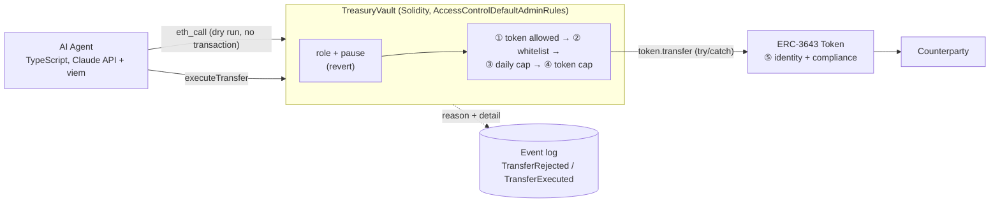

# Compliant RWA Treasury with an AI Agent

[](https://github.com/luk267/rwa-treasury-agent/actions/workflows/ci.yml)

Tokenized securities (real-world assets, RWAs) may only move between verified
holders. Under ERC-3643 the issuer enforces this inside the token: an identity
registry, compliance rules, frozen wallets. A treasury that holds such tokens
adds rules of its own on top: which tokens it moves, whom it pays, how much of
each token per counterparty per day, how much of each token may leave per day.

This project lets an AI agent run that treasury without trusting it. The agent
proposes transfers. A Solidity vault applies the treasury's rules, then hands
the transfer to the token, which applies the issuer's rules. The agent
dry-runs every transfer first and does not send one that would be refused.
A refused transfer that is sent anyway stays in the on-chain log with a typed
reason, including the token's own error.

The agent (TypeScript, `@anthropic-ai/sdk` + viem) runs a short tool loop over
the Claude Messages API with three tools: read holdings, simulate a transfer,
submit one. Its reasoning is observability, not authorization.

---

## Demo

Five scenes, replayed by [`scripts/demo.sh`](scripts/demo.sh) against the
local stack:

| Scene | Prompt                      | Outcome                                                         |
| ----- | --------------------------- | --------------------------------------------------------------- |
| 1     | `show the vault holdings`   | 100,000 MOCK in the vault                                       |
| 2     | `transfer 500 MOCK to cp1`  | Executed, within all limits                                     |
| 3     | `transfer 6000 MOCK to cp1` | Pre-check refused by the vault: cp1's daily cap is 5,000 MOCK   |
| 4     | `transfer 100 MOCK to cp3`  | Pre-check refused by the token: `UnverifiedIdentity()`, no KYC  |
| 5     | none, `cast send`           | Scene 4's transfer sent anyway: `TransferRejected` in the log   |

Scenes 3 and 4 stop at the pre-check: one `eth_call`, no transaction. The
agent's prompt forbids sending a transfer the dry run refused, so these
refusals leave no trace on the chain. Scene 5 shows what happens when a
refused transfer is sent anyway, for example by a faulty or compromised
agent. It runs without the Claude API: `cast send` submits scene 4's transfer
from the agent's account, and `cast logs` reads the vault's entry back with
reason 5 (`ERC3643Compliance`) and detail `0x58c10a24`
(`UnverifiedIdentity()`). That entry is what a monitor finds.

Scene 4 from a real run, shortened (`[...]` marks the cuts):

```text
=== Scene 4/5: Refused in the pre-check: unverified identity ===
> transfer 100 MOCK to cp3

→ get_portfolio({})
← { [...] "symbol": "MOCK", "balance": "99500" [...] }

→ check_transfer_feasibility({"token":"0x5FbDB2315678afecb367f032d93F642f64180aa3","to":"0x976EA74026E726554dB657fA54763abd0C3a0aa9","amount":"100"})
← {
  "feasible": false,
  "reason": "ERC3643Compliance",
  "detail": {
    "raw": "0x58c10a24",
    "decoded": "UnverifiedIdentity()"
  }
}

I didn't send the transfer because the dry-run was rejected. **No transfer
was made.**

**Why it was rejected:** The MOCK token itself refused it (`ERC3643Compliance`,
error `UnverifiedIdentity()`). cp3 (`0x976EA74026E726554dB657fA54763abd0C3a0aa9`)
has no verified identity (KYC) in MOCK's identity registry. [...]

**All the vault's own limits passed:**
- **Token allowed:** Yes. The vault holds 99,500 MOCK.
- **cp3 approved:** cp3 is an active counterparty.
- **cp3's daily cap:** 1,000 MOCK, with 0 used today, so 100 fits.
- **Vault's daily limit for MOCK:** 8,000 MOCK across all recipients, with 500
  used today, so 7,500 is left.
[...]
--- done (turns: 3) ---
```

Scene 5 from a real run, complete:

```text
=== Scene 5/5: The refusal in the on-chain log ===
> no agent: send scene 4's transfer from the agent account with cast

cast send <vault> "executeTransfer(address,address,uint256)" <MOCK> <cp3> 100ether
  from 0x9965507d1a55bcc2695c58ba16fb37d819b0a4dc, block 15, status success

cast logs --address <vault> --from-block 0 "TransferRejected(...)"
  TransferRejected entries in the chain: 1
  block 15, tx 0x0537c05625f0fc2c70f081d7d74d27a16cb90a8232fbe4a6ffefe363606aefea
    to     0x976ea74026e726554db657fa54763abd0c3a0aa9
    amount 100 MOCK
    reason 5 = ERC3643Compliance
    detail 0x58c10a24 = UnverifiedIdentity()
```

The transaction succeeds although the transfer was refused: policy decisions
are logged, not reverted (see [How it works](#how-it-works)).

The [Quick start](#quick-start) shows how to run it yourself.

---

## Status

Built during ETHGlobal Open Agents (24 April - 6 May 2026) and reworked since.
It runs end to end on a local Anvil chain and on the Sepolia testnet, both
times against `MockERC3643`, a test token modeled on T-REX v5.

Not audited. Not for production use.

---

## Live on Sepolia

Both contracts are deployed on Sepolia, and their source is verified on
Etherscan. The token is `MockERC3643`, the test double from this repo, not a
real T-REX token.

| What                                         | Link                                                                                                                                  |
| -------------------------------------------- | ------------------------------------------------------------------------------------------------------------------------------------- |
| `TreasuryVault`, verified source             | [`0xdc873f…DE5fD0`](https://sepolia.etherscan.io/address/0xdc873f0277b57Fc0e27e267857aDBea947DE5fD0#code)                             |
| `MockERC3643` (MOCK), verified source        | [`0xa95950…351357`](https://sepolia.etherscan.io/address/0xa95950a36216Fd3543f37AB71430F552Cb351357#code)                             |
| 100 MOCK to `cp1`: `TransferExecuted`        | [`0x32f251…a8950b`](https://sepolia.etherscan.io/tx/0x32f25118ee2d0312cafefebf716dc2f401ea3596190dbeef96792f0428a8950b#eventlog)       |
| 100 MOCK to `cp3`: `TransferRejected`        | [`0xcacd2a…c32091`](https://sepolia.etherscan.io/tx/0xcacd2af2829e450b280904ee93c7b7a99a6d5f5914978bde05025d69bcc32091#eventlog)       |

Both transfers were sent from the agent's key with `cast`, like scene 5 of the
demo. The rejected one is a successful transaction: the vault logs the refusal
instead of reverting. Its log entry, decoded by Etherscan, reads `reason` 5
(`ERC3643Compliance`, gate 5) and `detail` `0x58c10a24`, the selector of the
token's `UnverifiedIdentity()` error: `cp3` has no verified identity in the
token.

The policy matches the local stack: 100,000 MOCK in the vault, daily caps of
5,000 MOCK for `cp1` and 1,000 MOCK each for `cp2` and `cp3`, 8,000 MOCK per
day in total. `cp1` to `cp3` are placeholder addresses derived from a label,
so nobody holds their keys. Addresses and the deploy block are in
[`deployments/sepolia.json`](deployments/sepolia.json).

On the testnet one key holds `DEFAULT_ADMIN_ROLE`, `TREASURER_ROLE` and
`PAUSER_ROLE`, and it deployed the mock, so it is also the token's issuer.
The agent has a key of its own with `AGENT_ROLE` only. In production these
would be separate keys or multisigs.

---

## How it works

Three layers, none trusting the layer above: the agent proposes a transfer,
the vault applies the treasury's policy, the ERC-3643 token applies the
issuer's rules. The vault owns the tokens and the agent key holds only
`AGENT_ROLE`, so `executeTransfer` is the agent's only way to move them.



The vault follows one rule for refusals:

- **Authorization reverts.** A caller without `AGENT_ROLE`, any call while
  the vault is paused, and an amount of 0 revert. The caller had no right to
  ask.
- **Policy decisions are logged.** Five gates run in order. A refusal emits
  `TransferRejected(token, to, amount, reason, detail)`, and the transaction
  still succeeds:
  1. Token allowlist (vault)
  2. Counterparty whitelist (vault)
  3. Daily cap per counterparty and token (vault)
  4. Daily outflow cap per token, over all counterparties (vault)
  5. ERC-3643 compliance (token). The vault calls `token.transfer` in
     try/catch and keeps the token's revert data in `detail`. A token that
     fails without a reason (no revert data, which includes running out of
     gas, or `false`) makes the vault revert: that is not a policy decision.

`executeTransfer` returns the same outcome as
`(bool executed, RejectReason reason, bytes detail)`, so a calling contract
does not have to read logs.

The vault's gates are default-deny: an unknown token, an unknown recipient or
a cap that was never set blocks the transfer. "Unlimited" has to be set
explicitly.

A monitor therefore finds every blocked attempt with one `eth_getLogs` filter
on `TransferRejected`, without a trace API or an archive node. A successful
transfer emits `TransferExecuted` and updates the daily counters in the same
transaction.

Component responsibilities, the full transfer flow, the issuer's rights and a
comparison with Safe + Zodiac Roles, MetaMask Advanced Permissions and
ERC-8226 are in [`docs/architecture.md`](docs/architecture.md). Threats,
mitigations with their tests, and known limitations are in
[`docs/threat-model.md`](docs/threat-model.md). Two decisions have their own
records:

- [ADR-0001: Policy rejections emit an event instead of reverting](docs/adr/0001-emit-instead-of-revert.md)
- [ADR-0002: Separate roles, a guarded admin, and no upgrade mechanism](docs/adr/0002-admin-rights-and-no-upgradeability.md)

---

## Design notes

- **Defense in depth.** Four cheap vault checks run before the more
  expensive ERC-3643 call. The vault owns the tokens, so the agent has no
  path that skips the gates.
- **Counters update on success only.** `_dailySpent` and `_assetDailySpent`
  are written after `token.transfer` returns true. A rejected ERC-3643 call
  leaves the counters untouched (verified by
  `test_executeTransfer_erc3643Rejects_dailyCapNotConsumed`). Because the
  write follows the external call, `executeTransfer` has a re-entrancy guard
  (verified by `test_executeTransfer_reentrantToken_cannotBypassCaps`).
- **The pre-check explains, it does not protect.** The agent runs every
  transfer as an `eth_call` first and reads the return value, so it can tell
  the operator which gate would refuse. That is an aid for the operator and
  the model, not a control: on submission the vault runs every check again.
  The same holds for the `Proceed? [y/N]` prompt before each real transfer.

---

## Quick start

Requires Foundry 1.9.0 and Node.js 22+. After the clone, start each terminal
in the repo root.

Clone the repo with its submodules, then build and test the contracts:

```bash
git clone https://github.com/luk267/rwa-treasury-agent.git
cd rwa-treasury-agent
git submodule update --init --recursive
(cd contracts && forge build && forge test)
```

Start the local stack (Anvil + deployed vault + funded mock token):

```bash
./scripts/local-dev.sh
```

The script starts Anvil, deploys `TreasuryVault` and `MockERC3643`, allows
the token with a daily outflow cap, whitelists three counterparties with a
daily cap each, and writes addresses to `deployments/local.json`. The
token verifies the vault, `cp1` and `cp2`. It does not verify `cp3`, so a
transfer to `cp3` passes the vault's gates and is then rejected by the token
with `UnverifiedIdentity()`. Anvil runs until you press Ctrl+C.

In a second terminal, set up and run the agent:

```bash
cd agent && npm install
cp ../.env.example .env                # then set ANTHROPIC_API_KEY
npm start "show the vault holdings"
npm start "transfer 500 MOCK to cp1"   # asks "Proceed? [y/N]" before sending
../scripts/demo.sh                     # the five demo scenes
```

Every agent run calls the Claude API and uses a little API credit. Scene 5 of
the demo does not. See
[`agent/README.md`](agent/README.md) for flags, exit codes and configuration.

### Sepolia

The agent runs against the deployment above when `AGENT_NETWORK=sepolia`. It
then needs `RPC_URL_SEPOLIA` and `AGENT_PRIVATE_KEY` in `agent/.env`, and the
key must hold `AGENT_ROLE` in that vault:

```bash
cd agent
AGENT_NETWORK=sepolia npm start -- "show the vault holdings"
```

To deploy your own copy, [`contracts/script/Deploy.s.sol`](contracts/script/Deploy.s.sol)
reads the role addresses from the environment and takes the signer from the
command line, so no key is in the code. The signer must be `TREASURER`,
because the demo setup needs `TREASURER_ROLE`. The agent must hold no other
role. Foundry reads `RPC_URL_SEPOLIA` and `ETHERSCAN_API_KEY` from the shell
or from `contracts/.env`:

```bash
cd contracts
export ADMIN=0x… TREASURER=0x… PAUSER=0x… AGENT=0x… ADMIN_TRANSFER_DELAY=86400
forge script script/Deploy.s.sol:Deploy --rpc-url sepolia \
  --private-key "$DEPLOYER_PRIVATE_KEY" --broadcast --slow
forge verify-contract <mock> test/mocks/MockERC3643.sol:MockERC3643 --chain sepolia --watch
forge verify-contract <vault> src/TreasuryVault.sol:TreasuryVault --chain sepolia --watch \
  --constructor-args $(cast abi-encode "constructor(uint48,address,address,address,address)" \
    "$ADMIN_TRANSFER_DELAY" "$ADMIN" "$TREASURER" "$AGENT" "$PAUSER")
```

The script logs every address. Copy them into `deployments/sepolia.json`,
with the block of the first deployment transaction from
`broadcast/Deploy.s.sol/11155111/run-latest.json` as `deployBlock`.

---

## Stack

| Layer     | Tooling                                                                                                      |
| --------- | ------------------------------------------------------------------------------------------------------------ |
| Contracts | Solidity 0.8.38, Foundry 1.9.0, OpenZeppelin `AccessControlDefaultAdminRules` and `ReentrancyGuardTransient` |
| Token     | ERC-3643 (T-REX) interface; `MockERC3643` for tests and the demos                                            |
| Agent     | TypeScript (strict), Node 22+, viem, `@anthropic-ai/sdk`, zod                                                |
| CI        | GitHub Actions: `forge` fmt, lint, build, test; `tsc`, `npm test`                                            |

---

## Repository layout

```
contracts/
  src/TreasuryVault.sol         policy gate + ERC-3643 delegation
  src/interfaces/IERC3643.sol   minimal T-REX interface
  test/unit/                    unit tests, one suite per concern
  test/fuzz/                    fuzz tests: cap boundary, rejections, any amount
  test/invariant/               invariant suite and VaultHandler (random call sequences)
  test/mocks/MockERC3643.sol    T-REX v5-style test double: identity, freeze, pause, forced transfer
  test/mocks/                   plus small tokens that fail without a reason, burn gas or re-enter
  script/DeployLocal.s.sol      local Anvil deployment
  script/Deploy.s.sol           deployment to any network, roles from the environment

agent/
  src/index.ts                  entry point: setup, exit codes
  src/preflight.ts              chain-id check, operator prompt
  src/loop.ts                   tool loop over the Claude Messages API
  src/outcome.ts                decodes the token's revert data in TransferRejected
  src/tools/                    get_portfolio, check_transfer_feasibility, execute_transfer
  src/prompt.ts                 system prompt: simulate-before-execute, reject-reason mapping

docs/
  architecture.md               component layout, transfer flow, gate reference, alternatives
  threat-model.md               threats, mitigations with tests, known limitations
  adr/                          architecture decision records

deployments/
  sepolia.json                  Sepolia addresses and deploy block (local.json is generated)

scripts/
  local-dev.sh                  Anvil + deploy + write deployments/local.json
  demo.sh                       replays the five demo scenes against the local stack
```

---

## Tests

```bash
cd contracts
forge test -vv         # full suite, verbose
forge test --summary   # pass/fail summary
```

The suites cover the vault's gates, the role split and the ERC-3643 integration:

| Suite                                   | Focus                                         |
| --------------------------------------- | --------------------------------------------- |
| `TreasuryVault.Skeleton.t.sol`          | Constructor, roles, pause / unpause           |
| `TreasuryVault.Roles.t.sol`             | One account per role, two-step admin handover |
| `TreasuryVault.Whitelist.t.sol`         | Counterparty add / re-add / deactivate, whitelist gate |
| `TreasuryVault.DailyCap.t.sol`          | Daily cap per counterparty and token, overflow, day-bucket reset |
| `TreasuryVault.AssetCap.t.sol`          | Token allowlist, daily outflow cap per token  |
| `TreasuryVault.ERC3643Compliance.t.sol` | try/catch on the token's compliance check     |
| `TreasuryVault.IssuerRights.t.sol`      | Token-side rejections, issuer forced transfer |
| `TreasuryVault.ExecutionPath.t.sol`     | Zero amount, token without a reason, out-of-gas, re-entrancy |
| `TreasuryVault.fuzz.t.sol`              | Cap boundary to the wei, rejections without effect, any amount without a panic |
| `TreasuryVault.invariants.t.sol`        | Five invariants over random call sequences    |

The invariant suite lets Foundry call `VaultHandler` in random order: agent
transfers, time jumps of up to two days, issuer actions (verify, freeze, pause,
compliance, forced transfer), cap raises and counterparties switched off and
on again, 256 runs of 64 calls. The tokens include one the treasurer never
allowed and one that calls back into the vault; the counterparties include one
that was never whitelisted. After every call:

- `invariant_counterpartyDailyCapNeverExceeded`: no counterparty receives more of
  a token in one day than its cap.
- `invariant_assetDailyCapNeverExceeded`: no token leaves the vault faster in one
  day than its daily outflow cap.
- `invariant_vaultBalanceOnlyDropsWithExecutedOrIssuerAction`: the vault's
  balance equals its funding minus executed transfers minus the issuer's forced
  transfers.
- `invariant_countersMatchLedger`: the vault's daily counters equal the handler's
  own ledger of executed transfers.
- `invariant_handlerChecksHeld`: every executed transfer passed all gates and
  moved exactly its amount, every rejection changed nothing, and no transfer
  reverted.

The invariants show that the vault never lets too much out. That it does not
refuse a transfer that fits is shown by `testFuzz_dailyCap_boundary`.
`forge test --mc TreasuryVaultInvariants -vv` prints how many transfers the last
run executed and how many each gate rejected.

The agent's tests run with `cd agent && npm test`, without network or API
calls: the tool loop against a fake client, input and deployment parsing,
the chain-id check and the operator prompt, each tool's result from fixed chain
reads (feasible, rejected by a gate, rejected by the token, reverted), error
naming, receipt decoding, the decoder for the token's revert data, and the
agent's ABI and reject reasons against the compiled vault, in both directions.
That last test needs `forge build` in `contracts/` first.

---

## License

MIT - see [`LICENSE`](LICENSE).
