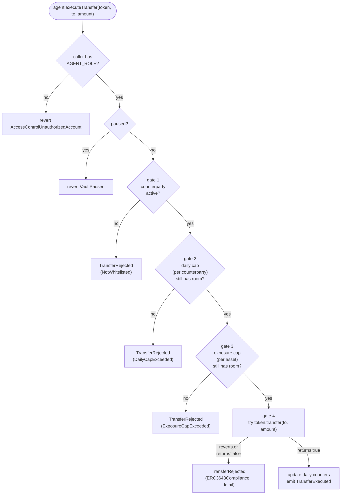

# Architecture

This document describes how `rwa-treasury-agent` is put together: the three
layers, the responsibilities of each component, the transfer flow through the
policy gates, and the trust assumptions behind it. Threats and known
limitations are in [`threat-model.md`](threat-model.md). Two decisions have
their own records: [ADR-0001](adr/0001-emit-instead-of-revert.md) (emit
instead of revert) and [ADR-0002](adr/0002-admin-rights-and-no-upgradeability.md)
(admin rights, no upgradeability).

---

## Glossary

| Term             | Meaning in this repo                                                                                   |
| ---------------- | ------------------------------------------------------------------------------------------------------ |
| AI agent         | The TypeScript program that proposes transfers. On-chain it is one key with `AGENT_ROLE` in the vault. |
| ERC-3643 agent   | The token issuer's operator, as defined by ERC-3643. It verifies identities, freezes, pauses and forces transfers. The mock calls it `ISSUER_AGENT`. |
| Issuer           | The party behind the ERC-3643 token. Owns the token's identity registry and compliance rules.          |
| Gate             | One policy check inside `executeTransfer`. A failing gate emits `TransferRejected`; it does not revert. |

"Agent" alone always means the AI agent.

---

## Three layers

The system has three layers, each one untrusted by the layer below.

| Layer       | Component                | Responsibility                                                                  |
| ----------- | ------------------------ | ------------------------------------------------------------------------------- |
| Reasoning   | TypeScript agent         | Decide what transfer to attempt; explain the on-chain outcome in plain language.|
| Policy      | `TreasuryVault.sol`      | Own the tokens; check role and pause; run gates 1–3; emit a structured outcome. |
| Compliance  | ERC-3643 (T-REX) token   | Gate 4: recipient identity, freeze, pause and compliance rules at the token.    |

The agent never holds tokens and is not trusted to follow rules. The vault
holds the tokens and is the only path for the AI agent to move them. The token
has the final say - even a vault-approved transfer can be blocked by ERC-3643
compliance. The issuer is not bound by the vault: ERC-3643 lets it move or
freeze the vault's tokens directly (see [Issuer rights](#issuer-rights)).

---

## Components

| Component                 | Role                                                                                                                       | Lives in                       |
| ------------------------- | -------------------------------------------------------------------------------------------------------------------------- | ------------------------------ |
| `TreasuryVault.sol`       | Holds ERC-3643 tokens. Runs gates 1–3, then calls the token's `transfer` (gate 4) and surfaces the outcome as an event.   | `contracts/src/`               |
| `IERC3643.sol`            | Minimal ERC-20 subset of ERC-3643. The vault calls only `transfer`; the agent reads `balanceOf`; `transferFrom` is unused. | `contracts/src/interfaces/`    |
| `MockERC3643.sol`         | Test double modelled on T-REX v5: checks pause, freeze, balance, recipient identity and compliance in that order and reverts with the v5 error names. Its deployer is the issuer agent: verifies wallets, freezes, pauses, forces transfers. | `contracts/test/mocks/`        |
| TypeScript agent          | Own tool loop over the Claude Messages API with three tools (read holdings, simulate, submit). Asks the operator before a real transfer. System prompt requires simulate before execute and maps `RejectReason` and the decoded token error back to plain language. | `agent/src/` |
| `DeployLocal.s.sol`       | Foundry script: deploys both contracts, verifies the vault, `cp1` and `cp2` in the token, funds the vault, whitelists three counterparties, sets an exposure cap. | `contracts/script/`            |
| `scripts/local-dev.sh`    | Starts Anvil, runs the deploy script, parses output, writes `deployments/local.json`.                                      | `scripts/`                     |

---

## Roles

The vault uses OpenZeppelin `AccessControlDefaultAdminRules` with three
role-gated capabilities and one admin.

| Role                 | Granted by  | Capabilities                                                                       |
| -------------------- | ----------- | ---------------------------------------------------------------------------------- |
| `DEFAULT_ADMIN_ROLE` | Constructor | Grant and revoke other roles.                                                      |
| `TREASURER_ROLE`     | Constructor | `addCounterparty`, `deactivateCounterparty`, `setExposureCap`.                     |
| `AGENT_ROLE`         | Constructor | `executeTransfer` - the only vault function that moves tokens.                     |
| `PAUSER_ROLE`        | Constructor | `pause`, `unpause`.                                                                |

The constructor takes one address per role. The deployer gets no role unless
it passes its own address. The agent's key therefore holds `AGENT_ROLE` only:
it cannot whitelist a counterparty, raise a cap, unpause, or grant itself a
role. The admin can grant and revoke all roles later.

The local stack uses one Anvil account per role:

| Account | Role                                |
| ------- | ----------------------------------- |
| #0      | `DEFAULT_ADMIN_ROLE`, deployer and token issuer |
| #1, #2  | Counterparties `cp1`, `cp2`         |
| #3      | `TREASURER_ROLE`                    |
| #4      | `PAUSER_ROLE`                       |
| #5      | `AGENT_ROLE` (the agent's key)      |
| #6      | Counterparty `cp3`: whitelisted in the vault, not verified in the token |

**Admin handover.** There is exactly one admin. `grantRole(DEFAULT_ADMIN_ROLE, …)`
is blocked. A handover takes two steps: the admin calls
`beginDefaultAdminTransfer(newAdmin)`, and the new admin calls
`acceptDefaultAdminTransfer()` once the delay has passed (one day in the local
stack). A typo in the address or a stolen admin key cannot move the role in a
single transaction, and the current admin can cancel during the delay.

**Stopping the agent.** The pauser calls `pause()`: every `executeTransfer`
reverts until `unpause()`. To lock the agent out for good, the admin calls
`revokeRole(AGENT_ROLE, agent)`.

---

## Transfer flow

`executeTransfer(token, to, amount)` first checks authorization, then runs
four gates in a fixed order:

- **Authorization reverts.** A caller without `AGENT_ROLE` reverts with
  `AccessControlUnauthorizedAccount`. While the vault is paused, every call
  reverts with `VaultPaused`. The caller had no right to ask.
- **Policy decisions are logged.** Each of the four gates either rejects the
  transfer (emit `TransferRejected`, return) or lets it through to the next
  gate. Gates 1–3 are the vault's own rules; gate 4 is the token's.

Two design choices are worth flagging:

1. **Policy rejections do not revert.** They emit `TransferRejected` with a
   typed reason and, for gate 4, the token's revert data. A monitor finds
   every blocked attempt with one `eth_getLogs` filter, without a trace API
   or an archive node. The agent layer treats `TransferRejected` as a normal
   outcome, not an error. The trade-offs (gas for rejected attempts, a
   "success" status in wallets) are in
   [ADR-0001](adr/0001-emit-instead-of-revert.md).
2. **Counters update only on success.** `_dailySpent[to][day]` and
   `_assetDailySpent[token][day]` are written *after* `token.transfer`
   returns true. A rejected ERC-3643 call leaves the counters untouched
   (verified by `test_executeTransfer_erc3643Rejects_dailyCapNotConsumed`).

For the source, see
[`contracts/src/TreasuryVault.sol:122-162`](../contracts/src/TreasuryVault.sol).

---

## Policy gates - reference

| Check | Stored as                                       | Configured by               | Behaviour                                                                                                              |
| ----- | ----------------------------------------------- | --------------------------- | ---------------------------------------------------------------------------------------------------------------------- |
| Auth  | OpenZeppelin role storage and `bool _paused`    | admin (roles), `pause` / `unpause` | Not a gate. Reverts without `AGENT_ROLE`, and reverts `VaultPaused` while paused. Hard stop for every attempt.  |
| 1     | `mapping(address => Counterparty) _counterparties` | `addCounterparty` / `deactivateCounterparty` | Recipient must have `active == true`. Deactivation is soft (preserves `addedAt` for audit). Emits `NotWhitelisted`. |
| 2     | `mapping(address => mapping(uint256 => uint256)) _dailySpent` | `addCounterparty(.., dailyCap)` | Per-counterparty per-day cap. Day bucket is `block.timestamp / 1 days`. Cap of zero means no transfer allowed. Emits `DailyCapExceeded`. |
| 3     | `mapping(address => uint256) _exposureCaps` and `_assetDailySpent` | `setExposureCap`             | Per-asset per-day outflow cap. `cap == 0` means unlimited. Aggregates across all counterparties for that token. Emits `ExposureCapExceeded`. |
| 4     | (delegated)                                     | the token contract          | `try token.transfer(to, amount)` - captures revert bytes in `detail`, or rejects on `false` return. Emits `ERC3643Compliance`. |

Reject reasons are carried in the `RejectReason` enum on the
`TransferRejected` event so an off-chain reader can branch on them without
string parsing. `RejectReason.Paused` exists in the enum but is never
emitted, because pause reverts.

---

## Why ERC-3643 (T-REX)

ERC-3643 (T-REX) is a Final ERC for permissioned security tokens. It must be
used with an on-chain identity system. A transfer succeeds only if:

- the sender has enough free (unfrozen) balance,
- the receiver is registered and verified in the token's identity registry,
- neither wallet is frozen and the token is not paused,
- the token's compliance contract allows it (`canTransfer` returns true).

The rule on identity applies to the receiver, not the sender. T-REX
`transfer` reverts on failure; it does not return `false`. T-REX 4.1.6
reverts with strings; the v5 line (beta) uses custom errors such as
`UnverifiedIdentity()`. The mock follows v5.

The vault calls only `transfer` and treats a token revert as an outcome
rather than an exception. It keeps the revert data in `detail`, so the agent
can name the token's reason. This keeps the vault independent of any specific
compliance-module implementation.

### Deployment prerequisite: the vault needs an identity

The vault is a token holder like any investor. Before it can receive a single
token, the issuer must register it in the identity registry with a verified
identity (an ONCHAINID in T-REX). This is a precondition for every deployment,
not an optional hardening step. The mock stubs it with `setVerified`, and
`test_fundVault_unverifiedVault_reverts` shows the funding transfer failing
without it.

---

## Issuer rights

ERC-3643 requires the issuer to keep control over every holder, the vault
included. The token interface gives the issuer's agents `forcedTransfer`,
full and partial freeze, `pause`, `recoveryAddress` for a lost wallet, and
`mint` and `burn`. None
of this goes through `executeTransfer`. The vault is not asked, emits no
event, and its daily counters do not change.

This is a feature of regulated assets, not a bypass of the design: the
vault's gates bind the AI agent, the issuer's rights bind every holder. The
mock models freeze, pause and forced transfer:

| Issuer action           | Effect on the vault                                                 | Test                                                       |
| ----------------------- | ------------------------------------------------------------------- | ---------------------------------------------------------- |
| Freeze the vault        | Gate 4 rejects every transfer with `FrozenWallet(vault)`            | `test_executeTransfer_vaultFrozen_emitsRejectedWithFrozenWallet` |
| Pause the token         | Gate 4 rejects every transfer with `EnforcedPause()`                | `test_executeTransfer_tokenPaused_emitsRejectedWithEnforcedPause` |
| Not verify a recipient  | Gate 4 rejects with `UnverifiedIdentity()`                          | `test_executeTransfer_recipientNotVerified_emitsRejectedWithUnverifiedIdentity` |
| Forced transfer         | Moves the vault's tokens; no vault event                            | `test_forcedTransfer_movesVaultTokensWithoutVaultEvent`    |
| Forced transfer         | Leaves both daily caps untouched                                    | `test_forcedTransfer_doesNotTouchDailyCounters`            |

Recovery, mint and burn are not modelled. All tests are in
[`TreasuryVault.IssuerRights.t.sol`](../contracts/test/unit/TreasuryVault.IssuerRights.t.sol).

---

## Trust model

| Component                       | Trusted to                                                             | Not trusted to                                        |
| ------------------------------- | ---------------------------------------------------------------------- | ----------------------------------------------------- |
| Agent (TypeScript)              | Propose a transfer, simulate it, explain the resulting event.          | Choose recipients, choose amounts, bypass any gate.   |
| Operator prompt (`Proceed? [y/N]`) | Let a human stop a transfer before it is sent.                      | Act as a security boundary: the agent key can call the vault directly, so the gates must hold on their own. |
| `TreasuryVault.sol`             | Check role and pause, apply gates 1–3, hand gate 4 to the token. Emit a faithful outcome event. | Decide jurisdiction / KYC / transfer-rule compliance. |
| ERC-3643 token                  | Final compliance decision (identity, claims, transfer rules).          | Provide reasoning suitable for off-chain explanation. |
| Admin / Treasurer / Pauser keys | Hold role management, the configuration authority and the kill-switch. | Nothing beyond that. Assumed honest here; see [ADR-0002](adr/0002-admin-rights-and-no-upgradeability.md) for what a production setup needs. |
| Token issuer (ERC-3643 agent)   | Verify identities, freeze wallets, pause the token, force transfers. ERC-3643 requires these rights. | Respect the vault's gates: a forced transfer moves the vault's tokens without a vault event and without touching its counters. |

The reasoning the agent emits off-chain is observability, not authorization.
The contract makes no assumption that the caller is honest, correct, or even
deterministic.

---

## Design alternatives

The core idea - a contract holds the assets, the AI agent gets a narrow role,
and the limits are enforced on-chain - is a common pattern, not an invention
of this repo. Three established or proposed designs solve similar problems:

- **Safe + Zodiac Roles Modifier v2.** A Safe holds the assets. The agent gets
  its own address and a role on the Roles Modifier, never an owner key. The
  role lists allowed calls, with conditions on parameters such as the
  recipient. Allowances meter amounts and call counts and refill on a
  schedule. A Delay Modifier can queue actions so the Safe owners can cancel
  them. Calls outside the role revert with `ConditionViolation`.
- **MetaMask Advanced Permissions (ERC-7715, redeemed via ERC-7710).** A user
  grants a session account a scoped permission from their MetaMask Smart
  Account: asset, amount, time window and transfer type, with periodic or
  streaming allowances, a start time and an expiry. Caveat enforcers reject
  executions outside the scope on-chain. The user can revoke any time.
- **ERC-8226 Regulated Agent Mandate (Draft).** A principal grants an agent a
  mandate per asset: a validity window, enabled actions, a per-transaction cap
  and a cumulative cap. An enforcer can freeze an agent or a principal.
  `canExecute(...)` returns `(bool ok, MandateReason reason)` with the first
  failing check, as a pre-check; the reference token gate reverts with
  `MandateBlocked(reason)`. Like this repo, it leaves investor eligibility to
  the ERC-3643 or ERC-7943 token and adds a separate layer on top.

| Capability                         | This vault                        | Safe + Zodiac Roles v2                 | MetaMask Advanced Permissions | ERC-8226 (Draft)                     |
| ---------------------------------- | --------------------------------- | -------------------------------------- | ----------------------------- | ------------------------------------ |
| Assets held by                     | The vault contract                | The Safe                               | The user's smart account      | The principal                        |
| Recipient restriction              | Counterparty whitelist            | Conditions on call parameters          | —                             | No                                   |
| Amount limits                      | Per counterparty per day, per asset per day | Allowances that refill on a schedule | Per period, or streamed  | Per transaction, cumulative per mandate |
| Limit on number of calls           | No                                | Yes (`CallWithinAllowance`)            | —                             | No                                   |
| Expiry of the agent's rights       | No                                | Planned for Roles v3, not deployed     | Yes                           | Yes (`validUntil`)                   |
| Delay / veto queue                 | No                                | Yes (Delay Modifier)                   | —                             | No                                   |
| Refused attempt                    | `TransferRejected` event, typed reason, transaction succeeds | Revert | Rejected on-chain (revert) | `canExecute` returns a reason; gate reverts |
| Token's ERC-3643 error kept on-chain | Yes, in `detail`                | No (revert discards logs)              | No (revert discards logs)     | No (revert discards logs)            |
| External audits                    | None                              | Several (G0 Group, Omniscia, Certora, Gnosis) | —                      | —                                    |

"—" means the cited source does not say.

**What they have that this vault lacks:** expiring rights, a delay queue,
call-rate limits, audits and production use. The Zodiac docs list Safe, ENS
DAO, Balancer, Gnosis DAO, Gnosis Pay and kpk as users. Audits are not a
guarantee either: in June 2026 an authorization bug in Roles v2.1.0 and Delay
v1.1.0 was exploited, mainly against Gnosis Pay accounts; patched versions
followed after a further audit.

**What this vault adds:** every refused attempt stays in the event log with a
typed reason, including the token's own ERC-3643 error, so a monitor finds it
with `eth_getLogs`. It has two cap dimensions at once (per counterparty and
per asset). And it keeps the split between the issuer's rules (in the token)
and the holder's rules (in the vault) explicit. The cost of the event design
is in [ADR-0001](adr/0001-emit-instead-of-revert.md).

Sources, opened on 2026-11-13: Zodiac,
[Permission an AI agent](https://docs.zodiac.eco/developers/roles/ai-agents),
[Roles Modifier](https://docs.zodiac.eco/developers/roles) and
[Security](https://docs.zodiac.eco/developers/security) (all updated
2026-11-09); MetaMask,
[Introducing MetaMask Advanced Permissions](https://metamask.com/news/introducing-advanced-permissions)
(2026-04-06); [ERC-8226](https://eips.ethereum.org/EIPS/eip-8226) (Draft,
created 2026-04-12, last changed 2026-10-09);
[ERC-3643](https://eips.ethereum.org/EIPS/eip-3643) (Final).

---

## Out of scope

These are deliberate omissions for the current iteration. They would be
required for a production deployment but are not part of the design goal,
which is to validate the three-layer policy + agent integration.

- **Multisig admin.** Each role sits on its own key, and the admin handover is
  two-step with a delay. The admin itself is still a single EOA, not a
  multisig. See [ADR-0002](adr/0002-admin-rights-and-no-upgradeability.md).
- **`SafeERC20`.** The vault calls `token.transfer` directly inside
  `try`/`catch`. A real T-REX integration would use the safe wrapper.
- **A real T-REX deployment.** The tests run against `MockERC3643`, which
  stubs the identity registry and the compliance contract as flags.
- **Mainnet or Sepolia deployment.** Currently local Anvil only. Sepolia
  is planned.

The known limitations of the current vault are listed in
[`threat-model.md`](threat-model.md#known-limitations).

---

## Where to look in code

| Concern                                              | File                                                                                                                            |
| ---------------------------------------------------- | ------------------------------------------------------------------------------------------------------------------------------- |
| Policy gates in order, event emissions, role checks  | [`contracts/src/TreasuryVault.sol`](../contracts/src/TreasuryVault.sol)                                                         |
| ERC-3643 surface used by the vault                   | [`contracts/src/interfaces/IERC3643.sol`](../contracts/src/interfaces/IERC3643.sol)                                             |
| Test double modelled on T-REX v5                     | [`contracts/test/mocks/MockERC3643.sol`](../contracts/test/mocks/MockERC3643.sol)                                               |
| Token-side rejections and issuer rights              | [`contracts/test/unit/TreasuryVault.IssuerRights.t.sol`](../contracts/test/unit/TreasuryVault.IssuerRights.t.sol)               |
| Role split and admin handover                        | [`contracts/test/unit/TreasuryVault.Roles.t.sol`](../contracts/test/unit/TreasuryVault.Roles.t.sol)                             |
| Threats, mitigations, known limitations              | [`docs/threat-model.md`](threat-model.md)                                                                                       |
| Design decisions                                     | [`docs/adr/`](adr/)                                                                                                             |
| Counters-not-consumed-on-reject test                 | [`contracts/test/unit/TreasuryVault.ERC3643Compliance.t.sol`](../contracts/test/unit/TreasuryVault.ERC3643Compliance.t.sol)     |
| Local deployment script                              | [`contracts/script/DeployLocal.s.sol`](../contracts/script/DeployLocal.s.sol)                                                   |
| Anvil bootstrap + deployment-info writer             | [`scripts/local-dev.sh`](../scripts/local-dev.sh)                                                                               |
| Agent entry point: pre-flight checks, exit codes     | [`agent/src/index.ts`](../agent/src/index.ts)                                                                                   |
| Tool loop over the Claude Messages API               | [`agent/src/loop.ts`](../agent/src/loop.ts)                                                                                     |
| Decoding the token's revert data in `detail`         | [`agent/src/outcome.ts`](../agent/src/outcome.ts)                                                                               |
| Two-phase simulation (revert + event logs)           | [`agent/src/tools/check-transfer.ts`](../agent/src/tools/check-transfer.ts)                                                     |
| System prompt with policy rules                      | [`agent/src/prompt.ts`](../agent/src/prompt.ts)                                                                                 |
